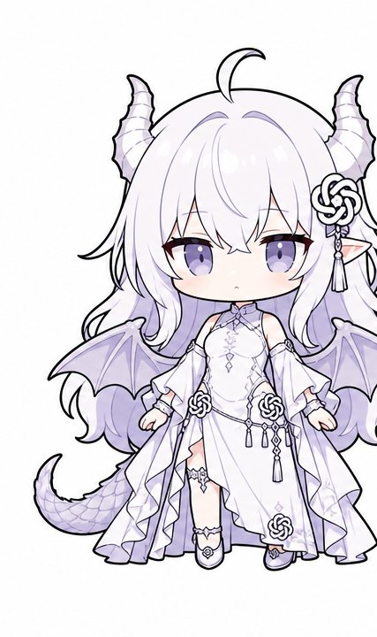
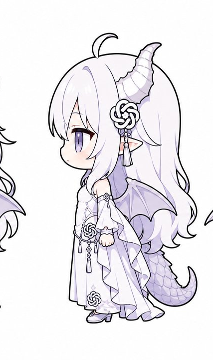
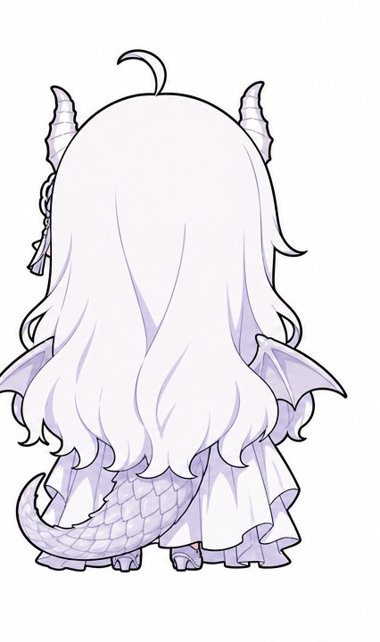

# 白色大肥龙 · 桌宠角色包（White Fat Dragon Pet Character Pack）

> 一套为 [MerZlin/dsh-pet-indesktop](https://github.com/MerZlin/dsh-pet-indesktop)（DeepSeek 桌面宠物）制作的自制角色素材包 + 黑底视频转透明素材的工具链。

<p align="center">
  
  
  
</p>

## 这是什么

- **一个完整的桌宠角色**：白色大肥龙（龙娘），包含 31 段循环动画（待机 1 / 点击回应 5 / 移动 4 / 转向 1 / 拖拽 1 / 随机动作 19）
- **一套素材加工工具**：把豆包等 AI 生成的「黑底视频」自动抠像、加描边、编码为 dsh-pet 可直接使用的透明 WebM
- **不是**完整的桌宠程序——程序本体请到上游项目获取（见「安装」）

## 安装

### 前置

1. 安装 [dsh-pet-indesktop](https://github.com/MerZlin/dsh-pet-indesktop)（Windows 桌面版，官方 Release 解压即可）
2. 本机有 PowerShell 5.1+ 与 ffmpeg（工具会自动使用 dsh-pet 自带的 ffmpeg）

### 安装角色

```powershell
# 把 characters\white_fat_dragon 复制进 dsh-pet 安装目录
# 并在配置中把角色切到 white_fat_dragon
.\tools\install.ps1 -PetDir "C:\path\to\dsh-pet-standalone-webm-chat"
```

脚本会：

1. 复制 `characters\white_fat_dragon\` 到 `_internal\assets\characters\white_fat_dragon\`
2. 备份并修改 `%APPDATA%\dsh-pet-standalone-webm-chat\config.json`，把 `character` 改为 `white_fat_dragon`，并在 `character_aliases` 里登记显示名「白色大肥龙」
3. 提示重启桌宠

> 想换回原角色（蓝色大肥鱼）时，把 `character` 改回 `shenshen` 即可。

## 动画结构

```
characters/white_fat_dragon/
├─ videos/
│  ├─ manifest.json          # body_box / head_box（640x360 坐标）
│  ├─ move_strides.json      # 移动动画步距与逐帧位移曲线
│  ├─ idle/                  # 待机（1）
│  ├─ click/                 # 点击回应（5）
│  ├─ move/                  # 移动：左转奔跑 / 漂浮踏步 / 螃蟹走路 / 芜湖起飞（4）
│  ├─ turn/                  # 转向：东张西望（1）
│  ├─ drag/                  # 被拖拽：被鼠标拖拽悬空（1）
│  └─ random/                # 随机动作（20）
└─ ...
```

素材规格（与上游一致）：

- 容器：带 alpha 的 WebM（VP9 + yuva420p）
- 分辨率：640×360，24fps，约 10 秒循环
- 命名：中文动作名

## 素材制作管线

AI 视频（豆包等）生成的是**黑底 MP4**，dsh-pet 需要的是**带 alpha 的 WebM**。本仓库附带工具完成转换：

```powershell
.\tools\key-black.ps1 -InputDir .\raw -OutputDir .\characters\white_fat_dragon\videos\random
```

处理步骤：

1. 缩放到 640×360
2. **区域生长抠像**：从画面边缘生长，只把与边缘连通的暗色当背景——角色内部深色（睫毛、眼睛、阴影）不会被误伤
3. **灰黑封闭块清理**：清除被角色包围的深色背景块（尾巴与身体间的封闭黑块），同时保护低饱和判定，避免吃掉深色眼睛
4. **独立小部件保护**：漂浮光球、礼物盒等不连通部件可选择保留（`-KeepSmallParts`）
5. **5×5 多数滤波平滑**（不做腐蚀，避免细尾巴被切断产生黑块）
6. **1px 实心描边 + 两级抗锯齿过渡**（可 `-NoOutline` 关闭）
7. VP9 + yuva420p 编码（CRF 18）

### 参考视频（给 AI 生成用）

```powershell
.\tools\make-720p-reference.ps1 -InputDir .\clips -OutputDir .\desktop
```

把 640×360 素材升采样成 1280×720 MP4——豆包等平台要求参考视频分辨率在 409600–2086876 像素之间。

## 三视图与角色设定

见 [`docs/character-design.md`](docs/character-design.md)。

## 致谢

- [MerZlin/dsh-pet-indesktop](https://github.com/MerZlin/dsh-pet-indesktop) — 桌宠程序本体
- 角色形象与动画由豆包 AI 生成，经本项目工具链处理
- 抠像工具参考了上游 `scripts/chroma_step02.py` 的编解码思路

## 免责声明

- 本仓库**不包含** dsh-pet 程序本体，仅包含自制角色素材与其加工脚本
- 素材仅用于个人桌宠装饰，角色形象版权归创作者与生成工具方所有
- 使用本仓库内容造成的任何问题由使用者自行承担

## License

MIT（脚本部分）。素材文件版权见上。
